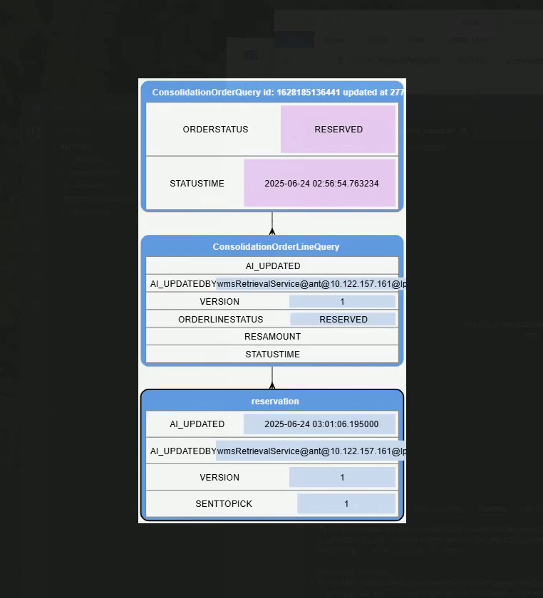

<script
    src="https://code.jquery.com/jquery-4.0.0.slim.min.js"
    integrity="sha256-8DGpv13HIm+5iDNWw1XqxgFB4mj+yOKFNb+tHBZOowc="
    crossorigin="anonymous">
</script>

<script data-goatcounter="https://maxdurbin.goatcounter.com/count"
        async src="//gc.zgo.at/count.js"></script>

<script src="/maxdurbin/assets/js/renderTable.js"></script>
<script type="module" src="/maxdurbin/assets/js/obs_example.js"></script>

# **Software Support Engineer**
***Working at Schaefer Systems International (SSI) since 2022***

Hello, my name is Max and though my position is "Software Support Engineer" me and my coworker do allot more than that at Schaefer.
We are both very familiar with SSH and SQL, but we also use Bash, Python, JS, and CSS.

We monitor and manage services and their servers by manually investigating issues and building tools. We develop and maintain our internal diagnostics site with over 100 users and recover operations from critical failure at any hour.

<a href="assets/MaxDurbin_Resume_B.pdf">ATS Resume pdf</a><br><a href="assets/MaxDurbinResume.pdf">Stylish Resume pdf</a>


<br>
***This is Our Building, we ship 115,000+ items per day to hundreds of locations***
<div class="video">
 <iframe width="560" 
     height="315" 
     src="https://www.youtube.com/embed/8ypcAtJOHbI?si=JMTbLQdDpypjjka2"
     title="YouTube video player"
     frameborder="0"
     allow="accelerometer; autoplay; clipboard-write; encrypted-media; gyroscope; picture-in-picture;" 
     referrerpolicy="strict-origin-when-cross-origin" allowfullscreen>
 </iframe>
</div>


---

# Work Experience

### Building Our Diagnostics Site

I rebuilt our website with a custom framework. We wanted it to be as simple and lightweight as possible.
I created a grid system for the layout and made templates for custom components and pages. The back end is a fourth the size it used to be
and the front end files have shrunk to about a third the size. 

The code is much more organized and adding features is so straightforward compared to the headaches we handled before.
This and automated reporting has reduced hours of workload every day in multiple departments.

Here's an example of the grid system.

<!-- we should be able to escape this section-->


<div style="height:25px;"></div>

The [bootstrap grid](https://getbootstrap.com/docs/5.3/layout/grid/) inspired my grid system but we required rows and nestable layouts.
*This defines the layout, an updater looks for target id's and manages the components from there.*
<!--needs CSS for syntax highlighting-->
```html
<div class='container' style='height:200px;'>
 <div class='row row-12'>
  <div id='table_ex0' class='col-4'></div>
  <div id='myplot' class='col-4'></div>
  <div class='col-4 subGrid'>
   <div class='row row-6'>
    <div id='table_ex2' class='col-8'></div>
    <div id='table_ex3' class='col-4' style='--dc-default-blue: firebrick;'></div>
   </div>
   <div class='row row-6'>
    <div id='table_ex4' class='col-12'></div>
   </div>
  </div>
 </div>
</div>
```

<br>

### Rapidly Developing Diagnostic Tools 

In November I was asked to read log files containing byte messages 
we call telegrams to verify what a machine was being asked to do.
The telegrams are stored with other information reaching almost 400,000 lines per day.

Below our "case wheeler" machine is on the left.
In the picture the wheels are illuminated for a camera encased in a shroud directly above.
The feed is processed by a java service.

Now we can visualize and verify the messages being sent by our java service.
Red means break, 0 with a green underscore means the wheel will freely spin
and a numbered arrow asks the wheel to move some distance. 


<div class="container" style="aspect-ratio: 16/9;">
 <div class="row row-12">
  <div class="col-3">
   
  </div>
  <div class="col-9">
   
  </div>
 </div>
</div>
<br>

### Data Analysis [Script](https://github.com/Max-Durbin/share/blob/main/perf_monitoring_weighted_average_stats.py)

LMS reported really bad performance on a few days when supervisors reported otherwise.

The customers LMS company said Schaefer must be failing to send the proper messages that pause the workflow.
The data was easy to review and that wasn't happening but it took over two weeks to move past.

We got a hold of some data from the LMS company through Mclane.

I wrote a script to explore the idea that there could be some factor who's difficulty wasn't being taken into proper account on particular days.

Here's an example snip of some **_assignments grouped by pounds_**. 
**_Assignments_** are measured as the **_goal seconds_** vs **_real seconds_** taken to complete.
You can see performance decrease as cases get heavier (pounds on the left), meaning the
physical weight of a case was not being taken into proper account.

You should be just as likely to complete a 5 second goal with 100% performance as a 60 second goal. Same for weight or any other factor.
It's the performance monitoring systems responsibility to accurately take into account harder work and give you proportionately more time to complete a more difficult job.
If we can identify factors that always correspond to poor performance - they probably aren't being accounted for correctly. 

<div class="container" style="aspect-ratio: 16/8;">
 <div class="row row-10">
  <div class="col-1"></div>
  <div class="col-10">
   
  </div>
  <div class="col-1"></div>
 </div>
 <div class="row row-2">
  <div class="col-1"></div>
  <div class="col-10">
  <p>
Note - 'weight' here refers to total assignment time contribution.
  </p>
  </div>
  <div class="col-1"></div>
 </div>
</div>


We had multiple things like weight that weren't being taken into proper account. 

The next step was to ask
"Of these factors which of them was high enough on those particular days to account for the drop"

The issue was our systems track assignments in full seconds which
was too inaccurate to set fair goals at low times and they round down meaning small assignments are nearly impossible.
They still use this same script so I'm proud of that, but the issue was too expensive to fix through the proper channels.

<br>

### SSH

We automate workflows, monitor/configure services, investigate and trace errors.

Some of our cronjobs are saving operations multiple hours of machine time.

I added some bash scripts for restarting our java services more quickly. 


Being able to understand the services and communication channels directly on the server has helped me trace issues more
effectively. Learning about vim and how to effectively navigate has been a project in itself. 

---

<br>

# Home Projects


### Sequence Mining

Algorithmically breaking down processes in order to push things forward/back. I wrote my own
sequence mining algorithm with hierarchical handling to predict what happens next in a given workflow/process

We can generate an interactive workflow overview that display what fields for the child records
must be populated or updated in order for a parent to proceed to the next step.


<br>

### Coming Soon! Resume A B testing results

<div class="container" style="height:250px;">
 <div class="row row-12">
  <div class="col-3">
   <p>
    Resume
   </p>
   <a href="assets/MaxDurbinResume.pdf">Resume pdf</a>
  </div>
  <div class="col-1"></div>
  


  <div style="text-align: right;" class="col-4">
   
  </div>


  <div style="text-align: right;" class="col-4">
   
  </div>

</div>
</div>


---
<!-- do i need a footer?-->

This page was made using Jekyll static site generator with GitHub's MD CSS files
<div style="height: 30px;"></div>
